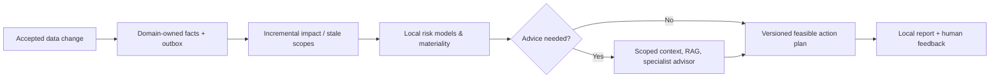

# wAInery — Smart Winery AI

**Product:** local-first decision intelligence for growing grapes and making wine in Poland.  
**Implementation status:** Gate1 technical foundation implemented with177 actual
contract/PostgreSQL/process tests; human Gate1 review and admin main protection
pending. The decision MVP and scientific evaluation are future work. Historical
design-stage gate labels do not authorize implementation milestones. See
[Gate1 review/demo](agents/handoffs/GATE-1-review.md) and [business HLD](docs/10-architecture/business-hld.md).

## Business HLD — what the product must do

For a specific **vineyard block or wine batch**, wAInery recommends **what to do next, when and why**. It should compare **multiple feasible actions**, including measure-first, wait or do nothing, explain dependencies/risks and cite applicable evidence. It must account for the vineyard's **Polish microclimate, varieties, phenology and real operational history**, not rely primarily on generic book advice.

**MVP inputs:** 1–2 privately scanned books, curated online sources, owner-written descriptions of vineyard/cellar activities and observations, one free forecast API.  
**MVP output:** a persisted, versioned action plan and local report with priority, time window, alternatives, rationale, missing data, evidence and qualitative uncertainty. **Percentages appear only when justified by an independently assessed model.**



Every accepted change must lead to **dependent** prediction assessment; it must **not** trigger all models/agents. The owner confirms actual work; an AI suggestion never becomes a performed operation automatically. The offline/local MVP does not guarantee alerts while the computer is off.

## Architecture at a glance

| Core bounded contexts | Supporting contexts | Platform modules |
|---|---|---|
| **Vineyard** — land/varieties/field work; **Winery** — batches, vessels and cellar operations; **Decisions** — predictions, alternatives and plans | **Observations** — typed measurement quality; **Weather** — immutable forecasts; **Knowledge** — copyrighted books/web evidence and RAG | **Connectivity** — adapters, source receipts, replay; **AIExecution** — model/provider/agent gateway and cost/egress policy |

One local **.NET 10 modular monolith + PostgreSQL/pgvector + private files**; pay-per-use external AI only when justified. Cross-module communication is through owner-controlled contracts, no direct foreign EF entities or writes. Future sensors, station, new measurements, model vendors, UIs, notifications, cloud and multi-tenancy are **extension stages**, not extra MVP services. Additive schema migrations are acceptable; canonical facts and source provenance must survive.

## Business acceptance and safeguards

- Expert-review **30–50 representative cases** for safe next action, time, multiple acceptable alternatives, citation grounding and Polish applicability; compare against cheaper baselines. **The goal is not yet measured.**
- Test scoped recomputation, as-of forecast/operations replay, budget limits, idempotent restart and the absence of unnecessary LLM calls.
- Private scanned books and derived content remain in protected local storage, outside Git. Source rights and external model egress policy apply before evidence leaves the computer; no public access required for MVP.
- **Parallel implementation:** compiled public contracts and actual migration/atomic outbox/lease tests now establish the technical foundation. Owner implementations and working weather→plan vertical remain future approved gates; see [delivery roadmap](agents/handoffs/GATE-0-plan.md).

## Documentation

Start with the [business HLD](docs/10-architecture/business-hld.md), [architecture guardrails](docs/00-governance/architecture-guardrails.md), [bounded context map](docs/20-domains/context-map.md), [component design](docs/30-components/overview.md), [LLD index](docs/90-lld/README.md), [contract freeze](docs/90-lld/implementation-contract-freeze.md), [evaluation protocol](docs/90-lld/evaluation-protocol.md), [delivery plan](docs/80-delivery/implementation-dag.md) and [agent collaboration rules](AGENTS.md).


## Monorepo for implementation

The .NET10 [solution](wAInery.slnx) has22 projects: eight module Contracts and
eight implementation shells, BuildingBlocks, Persistence, Host and three test
projects. Public ports compile; four immutable/additive migrations run on actual
PostgreSQL/pgvector. Atomic outbox/inbox dispatch and fenced durable jobs have
real retry/rollback/concurrency tests. Host validates startup DB compatibility,
binds loopback and exposes built-in live/ready. No domain command handler,
prediction/ranking, RAG, model executor or agronomic evaluation implemented yet.

```bash
dotnet restore wAInery.slnx
dotnet build wAInery.slnx --configuration Release
dotnet run --project tests/Architecture/wAInery.ArchitectureChecks.csproj --configuration Release
dotnet test --solution wAInery.slnx --configuration Release
```

For reproducible synthetic demo and actual local startup commands see
[Gate1 procedure](agents/handoffs/GATE-1-review.md) and [bootstrap](docs/80-delivery/monorepo-bootstrap.md).
Implementation Gate2 requires explicit `APPROVE GATE 1`.

## How to implement with coding agents

For the MVP use **VS Code + Codex in scoped Git worktrees**, not an uncontrolled swarm. Four implementation workstreams share one Integration Owner and independent QA; start with one or two coding sessions, only expand after Wave 0 contracts and Postgres migrations work. Each PR must be tested, independently reviewed, cost-aware and traceable to a business outcome.

- [Mandatory agent instructions](AGENTS.md)
- [Agent team and domain ownership](docs/00-governance/agent-team-topology.md)
- [SDLC, branch and review policy](docs/80-delivery/agentic-sdlc.md)
- [Testing and evaluation gates](docs/70-quality/implementation-test-strategy.md)
- [Codex IDE and Git worktrees](docs/80-delivery/codex-development-workflow.md)
- [Agent assignment template](agents/templates/implementation-task.md)

**Current CI:** restore/Release build, real positive/negative architecture CLI,
contract and actual PostgreSQL/process integration suites, wire schemas/negative
fixtures, skill validation and PR freshness. No paid model/live weather/private
document dependency. 30–50 expert decision scenarios remain future Gate6 work.

## Git workflow for implementation teams

**Trunk-based development:** `main` is the only permanent integration branch. One small, independently testable feature per short-lived branch/worktree; **fetch + rebase onto current `main`** before final tests/review; **squash merge** to keep history clean; delete merged branch and worktree. Do not begin long-lived per-module or `develop` branches. See [mandatory agent collaboration rules](docs/00-governance/trunk-based-collaboration.md), [SDLC](docs/80-delivery/agentic-sdlc.md) and [PR checklist](.github/pull_request_template.md).

## Shared agent knowledge and reusable skills

Implementation agents share **reviewed engineering lessons and patterns** in [agent knowledge base](agents/knowledge/README.md). Repo-local Codex workflows are in [`.agents/skills/`](.agents/skills/) with a [skill registry](agents/knowledge/skill-registry.md). The Architect reviews repeated integration tasks and promotes *stable, testable, genuinely useful* procedures into reusable skills; agents exchange contract-focused handoffs and verify each other's assumptions. The practice is governed by [Agent Learning & Skills Policy](docs/00-governance/agent-learning-and-skills.md). These assets are **developer knowledge, separate from the winemaking book RAG**. Start the coordinated rollout with the [orchestrator prompt](agents/prompts/implementation-orchestrator.md); milestone progress and skill/learning summaries require human review before advancing.
