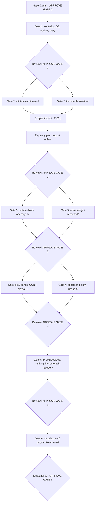

# Gate 0 — audyt i proponowany plan implementacji MVP

Data: 2026-11-01, Europe/Warsaw. Autor: Architect / Integration Owner.
Status: **APPROVED — użytkownik napisał `approve gate 0` dnia 2026-11-01. Autoryzowany jest wyłącznie Gate 1.**
Śledzenie: [GitHub Issue #8](https://github.com/bbielecki/wAInery/issues/8).
Plan zapisano w main przez właściciela w commicie a41a77c. Wyniki audytu poniżej są historycznym stanem Gate 0; aktualne dowody należą do Issues/PR Gate 1. Plan nie zmienia kontraktów ani zasad biznesowych.

## Zakres i źródła

Wykonano wyłącznie audyt, próby istniejących kontroli i planowanie. Nie zmieniono kodu aplikacji, schematów ani konfiguracji; nie utworzono gałęzi implementacyjnych i nie uruchomiono agentów.
Przeczytano AGENTS.md, prompt orkiestratora, wszystkie dokumenty w docs/00-governance, docs/80-delivery i docs/70-quality, Business HLD oraz istotne komponenty, kontrakty, SQL, LLD i zasoby agents/knowledge.

Źródła nadrzędne: [HLD](../../docs/10-architecture/business-hld.md), [BR-01..10](../../docs/10-architecture/business-requirements-traceability.md), [zespoły](../../docs/00-governance/agent-team-topology.md), [SDLC](../../docs/80-delivery/agentic-sdlc.md), [testy](../../docs/70-quality/implementation-test-strategy.md), [freeze](../../docs/90-lld/implementation-contract-freeze.md), [ewaluacja](../../docs/90-lld/evaluation-protocol.md).
Historyczne bramki dokumentacyjne 1–5 nie oznaczają ukończenia poniższych bramek implementacyjnych 0–6.

## Zweryfikowany baseline

| Obszar | Dowód i ograniczenia |
|---|---|
| Git | Lokalny main i lokalny origin/main: 7deeb6d65df1047974efd7b4e2985911df87c52a; jeden worktree, jedna lokalna gałąź. Przed audytem jedynie nieśledzony .vscode/. Nie czytano ani nie zmieniano jego zawartości. |
| Aktualność zdalnego main | Próba git ls-remote nie połączyła się z github.com:443. Nie wykonywano fetch/rebase; nie potwierdzono najnowszego zdalnego SHA. Dostęp konektorem GitHub działa. |
| GitHub | Repo publiczne. Przed utworzeniem #8 brak otwartych Issues i PR. PR #7 scalony do main jako 7deeb6d. Dozwolone są squash, merge commit i rebase merge; reguł ochrony gałęzi nie zweryfikowano. |
| CI | Head PR #7 fd17951ee48abf5764a2c19fa12d5eee56d07a52: [run 41253930833](https://github.com/bbielecki/wAInery/actions/runs/41253930833) SUCCESS; kroki restore, pełny build, granice modułów i skills SUCCESS. [Trunk run 41253930888](https://github.com/bbielecki/wAInery/actions/runs/41253930888) SUCCESS. Nie jest to dowód testów biznesowych ani niezależnego review. |
| Struktura | 19 projektów: BuildingBlocks, Host, 8 Contracts, 8 implementacji i ArchitectureChecks. Tylko trzy pliki C#: Primitives.cs, Host/Program.cs i Architecture/Program.cs. |
| Host | Ze źródła: http://127.0.0.1:5100/health/live, odpowiedź status=ok, service=wAInery, phase=scaffold. Brak połączenia z DB, endpointów biznesowych i workerów. Lokalnego uruchomienia nie wykonano. |
| Kontrakty | Pięć JSON Schema i pięć przykładów. Projekty Contracts nie zawierają publicznych portów/DTO biznesowych. Wspólne prymitywy istnieją. |
| Dane i testy | SQL jest blueprintem; brak wykonywalnego runnera migracji. Katalogi testów biznesowych zawierają README, bez projektów testowych. ArchitectureChecks jest programem konsolowym, nie pakietem unit testów. |
| Narzędzia | SDK dostępne: 3.1.100, 5.0.400, 6.0.201; brak .NET 10 wymaganego przez global.json. Docker CLI 28.3.0, daemon niedostępny i brak dostępu do .docker/config.json. Python 3.7.9, jsonschema 3.2.0. |

Polecenia faktycznie wykonane i wyniki:

| Polecenie / kontrola | Wynik |
|---|---|
| dotnet --info | Wykonane; brak SDK 10. |
| dotnet restore wAInery.slnx | Exit 1: brak kompatybilnego SDK 10.0.100; restore nie rozpoczął się. |
| dotnet build wAInery.slnx --configuration Release | Exit 1: ten sam brak SDK; kod nie został skompilowany. |
| dotnet run --project tests/Architecture/wAInery.ArchitectureChecks.csproj | Exit 1: brak SDK; program nie został uruchomiony. |
| python scripts/validate_agent_skills.py | PASS: pozytywny i negatywny self-test oraz metadane trzech skills. Nie dowodzi skuteczności ich workflow. |
| python tools/validate-gate3-contracts.py | ImportError: brak Draft202012Validator w jsonschema 3.2.0. Schematów/fixtures tym walidatorem nie zweryfikowano. |
| docker version --format '{{json .Server}}' | Brak demona/pipe; konfiguracja użytkownika niedostępna. Testcontainers i PostgreSQL nie zostały uruchomione. |
| Jednorazowy audyt Python stdlib przez stdin | Statycznie PASS: 19 projektów, istniejące referencje, poprawne granice Contracts i brak cykli; nie zastępuje ArchitectureChecks. |
| Ten sam audyt: JSON i linki | Pięć schematów parsuje się jako JSON; nie jest to walidacja JSON Schema. W 23 dokumentach 0 brakujących lokalnych celów linków; anchorów i URL nie sprawdzano. |
| dotnet test, migracje, unit/contract/integration/evaluation | NOT RUN: brak projektów i/lub środowiska. Nie deklaruje się PASS. |

Git odrzucał początkowo odczyt przez różnego właściciela katalogu. Odczyty wykonano z jednorazowym, ograniczonym do tego repo `git -c safe.directory=...`; bez zmiany globalnej konfiguracji.

## Luki wymagające zamknięcia

1. Brak skompilowanych publicznych DTO/portów. W docs/30-components/AIExecution.md nadal występuje ExecuteAsync, podczas gdy katalog kieruje do AdviseAsync w ports LLD. C# szkic DomainChange i wire v1 mają różną kompletność pól; freeze musi zapewnić jawne mapowanie, ownership i zgodność fixtures.
2. Świeżość PENDING_REEVALUATION/FRESHNESS_UNKNOWN musi być publicznie widoczna przed przetworzeniem outbox; istniejący enum planu v1 jej nie opisuje. Integrator ustali osobną metadaną read-model albo wersjonowany kontrakt, bez cichego łamania v1.
3. Brak runnera/testów PostgreSQL: wykluczenie sprzecznej obsady zbiornika, korekty tylko w jednym workspace, niezmienność payloadu użytej definicji predykcji, źródła/opaque IDs, typy/jednostki i replay. Złożony klucz definicji jest już w SQL, lecz nie dowodzi wykonania ani ochrony przed UPDATE.
4. Brak atomowego owner-write/outbox, inbox dedupe, kolejki z lease i retry limitami, selektywnego impact, CAS i as-of na rzeczywistym przepływie.
5. Brak OCR/RAG, wykonawcy AI z polityką i ledgerem, planów, raportów i danych eksperckich.
6. Dokumentacja ma historyczne statusy oczekujących PR, choć PR są zamknięte. ArchitectureChecks ma stałą liczbę 19 projektów; dodanie testów wymaga kontrolowanej aktualizacji tej kontroli.
7. GitHub workflow nie uruchamia walidatora pięciu schematów ani przyszłych testów biznesowych. Ochrona main i wyłączenie merge commits pozostają do potwierdzenia/konfiguracji.

## Role, allowlisty i model pracy

| Właściciel | Zakres |
|---|---|
| IO: Architect / Integration Owner | Host, BuildingBlocks, root/solution/CI/infra, centralny runner migracji, contracts, wspólne fixtures; publiczny freeze w osobnych PR; kuracja knowledge i skills. |
| A: Domain State | Vineyard i Winery, osobne zadania/PR, własne src/Modules/<Module>/** i tests/Modules/<Module>/**. |
| B: Data Acquisition | Connectivity, Weather i Observations, osobne zadania/PR i analogiczne allowlisty. |
| C: Knowledge & AI | Knowledge i AIExecution, osobne zadania/PR i analogiczne allowlisty. |
| D: Decisions | Wyłącznie Decisions i jego testy; impact, predykcje, ranking i plany. |
| QA | Osobny reviewer; przypisane tests/Contracts, Architecture, Integration, Evaluation; dowody testowe i przegląd praw/kosztów. |
| PO / ekspert | Człowiek akceptujący bramki, budżet i kryteria biznesowe; ekspercki przegląd porad ogrodniczych/enologicznych. |

Nazwy zespołów oznaczają odpowiedzialności, nie uruchomione procesy. Narzędzia native subagents są dostępne w tej sesji, lecz Gate 0 nie uruchamia żadnego. Gate 1 realizuje jeden IO, z osobnym reviewerem po przygotowaniu PR. Początkowo maksymalnie dwóch implementerów po fundamencie; większa współbieżność dopiero po udanym Gate 2 i w granicach realnych sesji/narzędzi. Przy braku takich sesji praca odbywa się kolejno; niezależność review nadal obowiązuje.

## DAG i punkty zatrzymania



Węzły K i AI są niezależnymi zadaniami w różnych modułach, mimo wspólnego strumienia C. Przed każdym PR producenta/consumera zależne kontrakty muszą już znaleźć się w main. Fakes odblokowują testy komponentu, nie zastępują odbioru pionu E2E. Zakres gate jest granicą autonomii: akceptacja planu uruchamia tylko Gate 1.

## Backlog proponowanych małych zadań

Poniższe ID są identyfikatorami planu, nie numerami utworzonych Issues. Wszystkie zadania są PROPOSED. Po akceptacji bieżącej bramki IO tworzy bounded Issue i work order według agents/templates/implementation-task.md, z jawnymi wersjami, allowlistą, fixture IDs, kosztem, warunkami odmowy i upstream. Każdy wiersz to cel osobnego PR; jeśli przekracza mały zakres, dzielimy go po zachowaniu, przed kodowaniem.

| ID / właściciel | Mały przyrost i BR | Zależność / pozytywny i negatywny dowód |
|---|---|---|
| G1-01 / IO | Powtarzalne wymagania środowiska i baseline; BR-10 | SDK 10, działający Postgres/container i izolowane, przypięte zależności walidacji; brak narzędzia daje jasny błąd. Bez obniżania global.json do SDK 6. |
| G1-02 / IO+QA | Wspólny envelope, identity/time/error i producer/consumer fixtures; BR-08/09 | G1-01; opaque subject ID działa, zły workspace/UTC/niepoprawny wynik odrzucony. Zamknięcie rozbieżności wire/C#. |
| G1-03 / IO | Read/command DTO i ports właścicieli; BR-01/06/09 | G1-02; konsumenci kompilują się przeciwko Contracts, nie encjom; nieznany ID i niewłaściwe scope odrzucone. Osobne małe PR dla seamów. |
| G1-04 / IO | Decisions-owned reasoning/read DTO, freshness i budżety kontraktów; BR-04/07/08 | G1-02; jedna nazwa AdviseAsync, zgodność v1 i jawna polityka wersjonowania. Nieudokumentowane pola/wyssane prawdopodobieństwa odrzucone. |
| G1-05 / IO | Wersjonowany runner i początkowa migracja PostgreSQL/pgvector; BR-10 | G1-01/02; clean DB + drugi start bez ponownego tworzenia; nieprawidłowa wersja migracji wykrywana. Wybór biblioteki runnera w krótkiej decyzji IO. |
| G1-06 / IO+QA | Brakujące ograniczenia schematu i wersji; BR-08/09 | G1-05; realny PG dopuszcza poprawną historię, odrzuca overlap/korektę obcego workspace/mutację payloadu użytej definicji. Aktywację wersji testujemy oddzielnie od jej niezmiennego payloadu. |
| G1-07 / IO | Transakcja owner write + durable outbox; BR-01/10 | G1-02/05; fixture-aggregate w izolowanym teście: commit obu albo rollback obu; crash po commit nie gubi zdarzenia. Rzeczywiste komendy właścicieli powtarzają dowód w Gate 2/3. |
| G1-08 / IO | Dispatcher/inbox/job lease i ograniczone retry; BR-01/05/10 | G1-07; duplikat dostawy ma jeden efekt, restart odzyskuje lease, poison-event osiąga DEAD bez nieskończonych retry. Jeden trwały dispatcher, bez brokera. |
| G1-09 / IO+QA | Wpięcie nowych testów w CI, polityka main i syntetyczny demo harness; BR-10 | G1-03..08; realne wykonanie suite, złamana granica/kontrakt blokuje PR. Usunąć stałe założenie 19 projektów w kontrolowany sposób. Potwierdzić ruleset/review/up-to-date/squash. |
| G2-01 / A:Vineyard | Minimalny blok, lokalizacja i potwierdzona fenologia; BR-03/09 | Gate 1 zaakceptowany; fixture MVP-WX-001: commit+outbox; brak fenologii/nieznany blok jawnie opisany. To minimum do pionu, nie cały Vineyard. |
| G2-02 / B:Weather | Niezmienne runy i known-at query; BR-01/09 | Gate 1; T-WX-02: run bez issuedAt zachowuje UNKNOWN, późniejszy retrieval nie przecieka do as-of; payload duplicate bez nowego skutku. |
| G2-03 / B:Connectivity | Receipt i forecast fixture dispatcher; BR-06/10 | Gate 1, G2-02 do E2E; forecast-hash-same i replay: zero podwójnego canonical write, błąd parsowania w kwarantannie. |
| G2-04 / B:Connectivity | Adapter jednej kwalifikującej się bezpłatnej prognozy, timeout/poll/checkpoint; BR-05/06/10 | G2-03; realny kształt odpowiedzi zapisany jako sanitizowany fixture, HTTP 429/outage nie niszczy checkpointu. Provider i warunki zatwierdzone przed użyciem; live smoke osobno, bez sieci w CI. |
| G2-05 / D | Mapowanie weather/block i selektywne invalidation; BR-01/05 | Gate 1, G2-01/02 do E2E; T-WX-01: A stale, B i partia X bez wpływu; 0 wywołań AI. |
| G2-06 / D | Deterministyczny P-001 i minimalne alternatywy; BR-02/03/08 | G2-05; brak etapu → INSUFFICIENT_DATA i inspekcja; brak udokumentowanego progu → UNKNOWN, żadnych wymyślonych %. Syntetyczna reguła nie jest naukową walidacją. |
| G2-07 / D | Persisted plan revision, read-model i lokalny raport; BR-04/09 | G2-06; czas, alternatywy, provenance, braki; przed obsługą outbox PENDING_REEVALUATION zamiast starego CURRENT. |
| G2-08 / IO+QA | Złożenie pionu, offline demo i restart; BR-01/04/10 | G2-01..07; MVP-WX-001, forecast-hash-same, outbox-crash; jeden biznesowy efekt, raport po restarcie, API cost=0. |
| G3-01 / A:Vineyard | Potwierdzenie rzeczywistej operacji; BR-08/09 | Gate 2 zaakceptowany; T-OP-01: draft nie jest historią, confirm commit+outbox, retry nie duplikuje. |
| G3-02 / A:Vineyard | Korekta i historia as-of; BR-01/09 | G3-01; zmiana po czasie nie przepisuje starego snapshotu; obcy workspace odrzucony. |
| G3-03 / A:Winery | Minimalna partia i zbiornik z historyczną obsadą; BR-08/09 | Gate 2; T-WIN-01: transfer zachowuje ID partii; overlap i niejednoznaczne przypisanie odrzucone. |
| G3-04 / A:Winery | Potwierdzona operacja piwniczna i korekta; BR-01/08/09 | G3-03; idempotentny confirm+outbox, błędny cel/czas/wersja nie daje wykonanej operacji. |
| G3-05 / B:Observations | Typowane pomiary/jednostki/quality i idempotency; BR-06/08 | Gate 2; T-OBS-01: pH, Brix i g/L rozdzielone; zła jednostka lub quarantined nie staje się canonical. |
| G3-06 / B:Observations | Korekta as-of i historyczne przypisanie do partii; BR-09 | G3-03/05; próbka przypisana według observedAt, późna korekta zmienia teraz, nie dawny as-of. |
| G3-07 / B:Connectivity | Ręczna notatka → strukturalna propozycja → owner confirm; BR-08 | G3-01/04; bez obowiązkowego LLM, parser/fake; niejednoznaczna partia pozostaje propozycją, replay nie omija zgody. |
| G3-08 / D+IO+QA | Minimalny P-003 i ścieżka piwnicy; BR-01/02/04 | G3-03..07; trend lub prośba o ponowny pomiar, brak diagnozy z jednej próbki; potwierdzona operacja aktualizuje tylko zależny plan. Osobne PR dla owner i Host. |
| G4-01 / C:Knowledge | Document vault, wersje i prawa; BR-08/09 | Gate 3 zaakceptowany; syntetyczny dokument lokalny rozwiązuje citation, path traversal/nieznane prawa odrzucone. |
| G4-02 / C:Knowledge | Lokalna ekstrakcja/OCR z anchorami i kwarantanną; BR-03/08 | G4-01; wygenerowany wielostronicowy skan testowy; błąd OCR nie publikuje nowego indeksu ani nie usuwa starego. |
| G4-03 / C:Knowledge | Indeks lexical+vector, wersja embedding space i atomic publish; BR-03/10 | G4-02; citation do poprawnej strony, zły wymiar/wektor space odrzucony, zmiana indeksu odwracalna. |
| G4-04 / C:Knowledge | Hybrydowe retrieval z kontekstem PL i resolve; BR-03/08 | G4-03; korpus dozwolony, diakrytyki/PL-EN, kontradykcje i źródło obcego klimatu; brak evidence nie generuje cytatu. |
| G4-05 / C:AIExecution | Neutralny executor z fake oraz egress/output/tool policy; BR-07/08 | Gate 3 i G1-04; T-KNW-01/02, T-DEC-04: DENY, injection, nieznany cytat, arbitralne % blokowane przed publikacją. |
| G4-06 / C:AIExecution | Rezerwacja budżetu, idempotentny usage ledger, timeout/fallback; BR-05/08 | G4-05; T-AI-01, współbieżna rezerwacja i retry wliczone, brak obchodzenia praw przez fallback. |
| G4-07 / C:AIExecution | Dwa adaptery różnych providerów zgodne z jednym portem; BR-07 | G4-06; wspólny contract suite na deterministycznych HTTP fixtures. Live smoke wybranej trasy tylko z zatwierdzonym limitem i dozwolonym payloadem; unit/CI bez sieci. |
| G4-08 / IO+D+QA | Złożenie evidence z lokalnym planem, rights revocation demo; BR-03/04/08 | G4-04..07/09/10; chronione teksty nie trafiają do API/logów/artefaktów; brak lub odmowa modelu pozostawia bezpieczny plan i jawne ograniczenia. Osobne owner/Host PR. |
| G4-09 / B:Connectivity | Import wybranych źródeł WWW z wersją, prawami i ograniczonym pobraniem; BR-03/08 | G4-01; allowlista, hashe/known-at i zapis provenance; redirect/private-IP/limit rozmiaru/nieznane prawa blokują import. HTTP fixtures w CI, live wyłącznie dla zweryfikowanych źródeł. |
| G4-10 / B:Connectivity | Lokalny file receipt i przekazanie importu do Knowledge; BR-08/10 | G4-01; checksum i limity; duplikat nie tworzy nowej wersji, błędny plik jest izolowany. Weryfikacja właściciela na 1–2 prywatnych książkach lokalnie, bez przesyłania ich do Git, CI ani sesji modelu. |
| G5-01 / D | P-002 i wspólny kontrakt P-001/002/003; BR-02/03 | Gate 4 zaakceptowany; próg/polityka ma wersję i evidence; brak krytycznych faktów daje UNKNOWN, nie interwencję. |
| G5-02 / D | Feasibility, prerequisite/exclusivity i ranking kompatybilnych działań; BR-02/08 | G5-01; measure/wait/no-action oraz wiele zgodnych działań; cykl zależności i twarde veto blokują wybór. |
| G5-03 / D | Materiality/coalescing/TTL i scoped knowledge changes; BR-01/05 | G5-01; T-DEC-01: 30 niematerialnych aktualizacji bez AI; brak tagów → ograniczony coverage audit; rights DENY ma pilną obsługę. |
| G5-04 / D | CAS i utrwalenie manifestu wejść przy publikacji; BR-01/09 | G5-03; T-DEC-02: starsza odpowiedź po nowych danych nie publikuje CURRENT; ponowienie z najnowszą rewizją. |
| G5-05 / IO+QA | Recovery E2E, dead-letter i backup/restore DB+files; BR-09/10 | G5-04; T-DEC-03, crash/replay; odtworzony audyt i pliki zgodne, brak dwóch operacji/planów z jednego zdarzenia. |
| G5-06 / D+IO | Feedback i trzy powtarzalne ścieżki raportu; BR-04/05 | G5-02..05; odbiorca potwierdza użyteczność planu oddzielnie od wykonania operacji; koszt/zaakceptowany plan obejmuje nieudane próby. Owner/Host osobno. |
| G6-01 / QA+PO | Zamrożenie 40 scenariuszy i rubryki; BR-02/03/08/09 | Gate 5 zaakceptowany; 14 weather/vineyard + 14 cellar + 6 change/replay + 6 missing/contradiction; oddzielny development set, hiddenFutureOutcomes poza context. |
| G6-02 / QA | Powtarzalny offline harness i manifest eksperymentu; BR-05/09 | G6-01; ten sam dataset/code/config daje porównywalne wyniki; naruszenie schema/egress/cost kończy run błędem. |
| G6-03 / QA+ekspert | Baselines/ablations, alternatywny model route i niezależna ocena; BR-02/03/05/07 | G6-02; facts-only, books-only, curated-web, history, hybrid, materiality; wymagane braki i niedozwolone wyniki oceniane przez człowieka, 2 reviewerów krytycznych przypadków. |
| G6-04 / IO+QA+PO | Raport jakości/kosztu, clean-start demo i decyzja ship/no-ship; BR-01..10 | G6-03; wyniki z denominatorami i odchyleniami, 0 krytycznych naruszeń, kontrola backup/restore i praw. Niespełniony cel → odpowiedni owner task i ponowny review, bez ukrytej zmiany progów. |

## Demo i techniczne/biznesowe kryteria bramek

Każda bramka dostarcza: commit/PR, niezależny review diff+testów, dokładne komendy uruchomienia, syntetyczny seed i hash, wejście/as-of, przewidywany wynik, checklistę manualną, wyniki PASS/FAIL/NOT RUN, koszty i Learning Digest. Brak wymaganego środowiska jest blockerem odbioru, nie warunkowym PASS.
Proponowany wspólny harness `scripts/demo.ps1 -Gate N -Offline` zostanie dopiero dodany w G1-09 i rozszerzany przez IO. Nie istnieje dzisiaj i nie został uruchomiony. W trybie offline nie może kontaktować się z weather/LLM ani używać prywatnego workspace.

| Gate | Powtarzalna demonstracja / wynik | Ręczna checklista odbioru |
|---|---|---|
| 0 | Audyt, tabela wyników i ten plan; lokalnego produktu jeszcze nie zademonstrowano. | Zweryfikuj HLD/role, kolejność i brak implementacji; zaakceptuj wyłącznie plan Gate 1. |
| 1 | Czysty rzeczywisty PostgreSQL z pgvector → migrate → ponowny migrate → atomic write/outbox → crash/replay. | Sprawdź wersję migracji, brak połowicznego zapisu, 1 efekt po duplikacie, poprawny odmowny overlap/workspace; zobacz logi testów i CI. |
| 2 | Bloki A/B i partia X; forecast A, druga identyczna prognoza, zmiana ryzyka, brak fenologii, restart. | A dostaje plan z czasem, alternatywami i evidence; B/X bez niepotrzebnej analizy; licznik AI=0; missing data jawne, brak %. |
| 3 | Syntetyczna notatka, podgląd draft, confirm/retry, transfer partii, pomiar/korekta z opóźnionym receivedAt. | Przed confirm brak wykonanej operacji; po retry jedna; ID partii stałe; jednostki i historyczny as-of poprawne; plan dotyczy właściwej partii. |
| 4 | Generowany skan i dozwolony korpus, OCR/retrieval/citation; DENY i cofnięcie praw; provider unavailable/budget=0/injection. | Otwórz wskazaną stronę wersji źródła; sprawdź transferability; przechwycony outbound i logi bez chronionych tekstów; ograniczony koszt i fallback. Właściciel dodatkowo sprawdza lokalny import 1–2 prywatnych książek; raportuje tylko techniczny wynik i bezpieczne identyfikatory. |
| 5 | Trzy ścieżki: weather→plan, nota→confirm→plan, korekta pomiaru→plan; race podczas reasoning, outage i restore. | Alternatywy i prerequisites wykonalne; stare runy odrzucone; właściwa świeżość; restart nie dubluje efektów; odzyskana historia i oryginały. |
| 6 | Te same 40 przypadków na baseline i wariantach; results.json, summary.md, usage.csv i formularze review. | Sprawdź wersje/hash/as-of, ręcznie wybrane przypadki pozytywne i krytyczne, rozwiązywalne cytaty, brak future leakage, koszt/accepted plan i rozbieżności ekspertów. |

Wstępne cele z zatwierdzonej specyfikacji ewaluacji wymagają potwierdzenia PO przed zamrożeniem danych: Top-5 evidence >=85%, state recognition >=90%, acceptable top plan >=80%, każda operacyjna rekomendacja z rozwiązywalnym evidence. Krytyczne warunki: 0 niebezpiecznych zakazanych działań, 0 sfabrykowanych %, 0 nieautoryzowanych egress, 0 zbędnych AI dla oznaczonych irrelevant fixtures i 0 obsolete CURRENT. To cele, nie zmierzone wyniki. Testy retrieval nie zastępują ocen porad; mały zbiór nie uzasadnia twierdzeń o skalibrowanej trafności prognoz.

## Dokładne obecne komendy lokalne

Wymagają doinstalowanego zgodnego SDK .NET 10. Dzisiaj pierwsze trzy kończą się błędem SDK; startup i HTTP poniżej są instrukcją do wykonania po przygotowaniu środowiska, nie dowodem działania.

```powershell
dotnet restore wAInery.slnx
dotnet build wAInery.slnx --configuration Release
dotnet run --project tests/Architecture/wAInery.ArchitectureChecks.csproj --configuration Release
dotnet run --project src/Host/wAInery.Host.csproj --configuration Release --no-build
```

W drugim terminalu:

```powershell
Invoke-RestMethod http://127.0.0.1:5100/health/live
```

Ze źródła oczekiwane status=ok, service=wAInery, phase=scaffold. Obecny Host nie wymaga DB do tej odpowiedzi; endpoint nie potwierdza gotowości bazy ani silnika decyzji. Komendy migracji, seed, demonstracji i biznesowego CLI/API podamy wraz z ich faktyczną implementacją i testami.

## Workflow i śledzenie postępu

1. Po APPROVE GATE 0 przygotować bounded work orders tylko dla Gate 1, z BR, modułem, allowlistą, upstream, frozen versions, fixtures, test planem i limitem API=0. Publiczny contract PR należy do IO; zmiana granic/praw/budżetu wymaga decyzji właściwego właściciela.
2. Jedno zachowanie na `agent/<module>/<issue-short-name>`, gałąź od aktualnego origin/main; osobny worktree przy realnej równoległości. Wyłączne ścieżki; centralne migracje i shared fixtures zawsze single-writer IO.
3. Najpierw test pozytywny i negatywny, potem minimalna implementacja. PR wprost do main. Fetch i rebase na najnowszy main przed final test/review/merge; jeśli main ruszy, powtórzyć. Green CI na nowym head i niezależny reviewer są obowiązkowe.
4. Squash po udanych kontrolach, potwierdzenie integracji, dopiero potem usunięcie scalonej gałęzi/worktree z ochroną lokalnej pracy. Brak direct push/force main i trwałych gałęzi integracyjnych.
5. GitHub Issue/PR to kanoniczny status; handoff zawiera wersje, pliki, dokładne testy, migracje/outbox, prawa i egress, koszt, review findings i blokady downstream. Ten plan nie jest równoległym dziennikiem postępów.
6. Po ukończeniu Gate 1 STOP po ludzki review i APPROVE GATE 1, analogicznie przy kolejnych Gate. Cisza, CI lub merge nie są akceptacją.

## Koszty, ryzyka i decyzje

- W Gate 0 nie wykonywano żadnych wywołań aplikacyjnych LLM/weather; koszt tych API=0. Koszt sesji Codex/subskrypcji i minut CI nie został zmierzony. Gate 1–3, standardowe CI i podstawowe demo pozostają bez płatnych API.
- Proponowane późniejsze ograniczenia na bazie LLD: $1/dzień i $5/miesiąc; $0.05 na scenariusz łącznie z wariantami i retry. 40 scenariuszy daje najwyżej $2 przy tym limicie, a smoke/próby rozwojowe muszą zmieścić się w reszcie miesięcznej puli. W razie braku jakości w limicie raportujemy ograniczenie; nie zwiększamy samowolnie budżetu. Nie jest to prognoza faktycznej ceny ani zgoda na prywatny egress.
- Brak nowych stałych usług/chmury/brokera. Lokalne CPU, dysk i Docker/alternatywny PostgreSQL pozostają kosztami istniejącego środowiska. Wybrany provider weather i model wymagają weryfikacji warunków/cennika przed użyciem. Bezpłatność forecast musi obejmować faktyczne zastosowanie, w tym status komercyjny; w razie braku kwalifikacji pozostają fixtures do decyzji PO.
- Przed produkcyjnym użyciem P-001/P-002 potrzebny jest przegląd fenologii, progów, mikrolokalizacji i prawnych ograniczeń. Gate 2 demonstruje architekturę na syntetycznej regule i bezpiecznych działaniach kontrolnych, bez deklaracji naukowej trafności.
- Repo jest publiczne. Handoff i Issues zawierają tylko stan techniczny i syntetyczne fixtures; prywatne książki, OCR, notatki, lokalizacje, raw prompts, sekrety i embeddings pozostają poza Git i zewnętrznymi modelami.
- Blockery wykonawcze: .NET 10, działający PostgreSQL/Testcontainers, zgodny validator i dostęp Git fetch/rebase. Przed merge osobno potwierdzić ochronę main i review. Nie omijamy kontroli przez obniżenie SDK, wyłączenie testów lub fałszywy green.
- Decyzje architektoniczne: zachować 8 właścicieli i 1 host+DB; Decisions jedynym właścicielem planu, AIExecution wykonawcą; brak nowego BC i interwencji automatycznej. IO rozstrzyga szczegóły compiled freeze i sekwencjonowanie migracji. Zmiana HLD/ownership/egress wymaga osobnej eskalacji/ADR.

## Learning Digest Gate 0

- Sprawdzono agents/knowledge: lessons i patterns są celowo bez certyfikowanych implementacyjnych wpisów. Nie dopisano niezweryfikowanej wiedzy; **No transferable finding** z ukończonego PR implementacyjnego, bo żaden nie powstał.
- Zastosowano [wainery-learnings-review](../../.agents/skills/wainery-learnings-review/SKILL.md) do tego podsumowania. Przy publicznych seamach użyjemy wainery-contract-change, a przed review/merge wainery-pr-verification; nie twierdzimy, że już wykonano nimi freeze lub review kodu.
- Po znaczącym PR autor przedstawia dowód, syntetyczny reproducer i ograniczenia; owner odbiorcy potwierdza wpływ; QA sprawdza także negatywny przypadek; IO kuruje lesson/pattern osobnym małym PR. Jeśli nie ma trwałego wniosku, handoff mówi No transferable finding.
- Kandydat do obserwacji: powtarzalna kontrola prerequisites/runnera demo. Najpierw skrypt+CI; nowy skill dopiero po co najmniej dwóch rzeczywistych powtórzeniach, wykazanej korzyści i kontroli braku duplikacji. Teraz nie utworzono nowego skill.
- Przy zatwierdzonej ekstrakcji zastosować skill-creator, osobny PR, właściciela, positive/negative triggers, testy i niezależną walidację; Architect akceptuje przed wpisem do registry. Nie kopiować HLD/kontraktów do knowledge.
- Zespoły A/B/C/D i QA mają opisany wpływ planu, lecz nie uruchomiono ich sesji i nie deklaruje się otrzymanego acknowledgement. Korzyści czasowe/tokenowe niezmierzone. Akceptowane lessons/nowe/wycofane skills: 0.

## Zatrzymanie

Gate 0 zatwierdził użytkownik dnia 2026-11-01 wiadomością `approve gate 0`. W Gate 0 nie było review implementacji, bo implementacja nie powstała.
Można realizować Gate 1. Gate 2 pozostaje zablokowany do APPROVE GATE 1; CI ani merge nie zastępują tej zgody.
