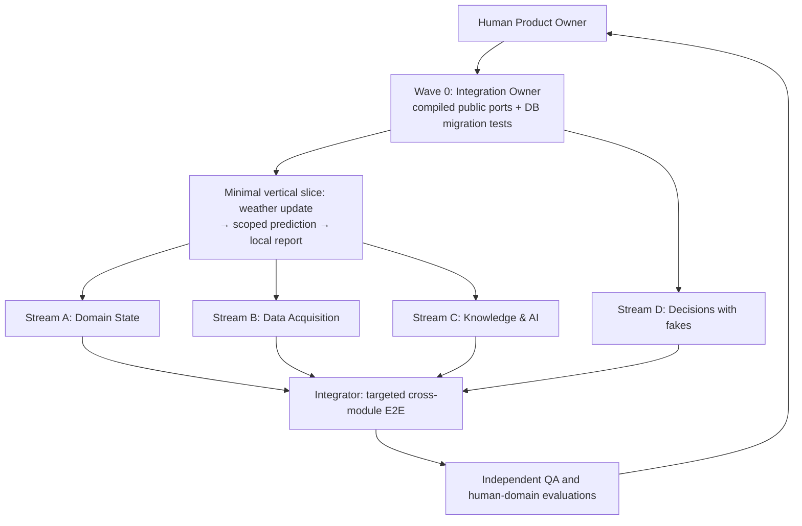

# Agent team topology — wAInery MVP

**Decision:** one monorepo, one Integration Owner, **four bounded implementation streams**, independent reviewer. **Do not instantiate eight standing agent teams just because there are eight modules.** All agents share the accepted [business HLD](../10-architecture/business-hld.md), [guardrails](architecture-guardrails.md) and [bounded context map](../20-domains/context-map.md). This page governs *implementation agents*; runtime AI advisors belong to `AIExecution` and are a different concern.

## Why this shape

The commercial hypothesis for the **private MVP** is useful, safe, Poland-relevant **next-action + timing + viable alternatives** using 1–2 private books, curated web, owner-verified operations and a free weather forecast. Every accepted change must update impacted prediction freshness without needless paid inference. Infrastructure is one local .NET modular monolith plus PostgreSQL/pgvector; remote/cloud services and live IoT are out of MVP.

Teams are **ownership streams**, not permanently running model processes. A single human developer may run one stream at a time; parallelize only when interfaces and fixtures are frozen.

## Accountability: people/roles and agent workstreams

| Role / stream | Accountable for | Owned areas | Dependencies and restrictions |
|---|---|---|---|
| **Product Owner (human)** | Product goals, budget, evaluation acceptability, safety approval, business prioritization | Acceptance criteria, selected test cases, product decisions | Final approval on business trade-offs; not replaced by AI-generated review |
| **Architect / Integration Owner** | Contract compatibility, dependency graph, persistence bootstrap/migration order, CI, release coordination, host composition | `src/BuildingBlocks/**`, `src/Host/**`, `contracts/**`, `wAInery.slnx`, `infra/**`, `.github/**`, shared migrations and cross-cutting tests | **Single-writer** for shared surfaces; reviews every cross-module contract change |
| **Stream A: Domain State** | Canonical operations, lifecycle and constraints in vineyards and cellar | `src/Modules/Vineyard/**`, `src/Modules/Winery/**`, matching module tests | No direct edits to other modules; performed work requires confirmation |
| **Stream B: Data Acquisition** | Source ingestion, weather runs, typed measurements, data quality and known-at semantics | `src/Modules/Connectivity/**`, `src/Modules/Weather/**`, `src/Modules/Observations/**`, matching tests | Raw receipt is not a confirmed action; normalizes through owner ports |
| **Stream C: Knowledge & AI Runtime** | Private OCR/RAG, evidence provenance, source rights, replaceable LLM and budget/egress enforcement | `src/Modules/Knowledge/**`, `src/Modules/AIExecution/**`, matching tests | Protected evidence stays local by default; no probability fabricated by an LLM |
| **Stream D: Decision Intelligence** | Impact dependency graph, predictions/revisions, feasible alternative ranking, versioned plan/report | `src/Modules/Decisions/**`, matching tests | Depends only on other modules' **Contracts**; LLM optional; decisions are business-owned |
| **Independent QA / Reviewer** | Black-box cross-module tests, adversarial cases, cost/traceability audit, PR review independent of author | `tests/Architecture/**`, `tests/Contracts/**`, `tests/Integration/**`, `tests/Evaluation/**` by assignment | Cannot be the sole judge of own code or model-generated evidence |
| **Domain reviewer (human, ad hoc)** | Validate viticulture/enology recommendations and forbidden actions in Polish conditions | Review records and golden scenarios | May be Product Owner initially; record limitations, disagreements and no-action options |

**Team count:** four implementation workstreams + one Integration Owner; QA and specialist review are gates, **not two more always-running services**. At the start run **1–2 Codex coding sessions plus Integration Owner**; add a third stream only after Wave 0 and a passing vertical slice. Cap concurrency to the number of genuinely isolated worktrees/tasks, not number of agent personas. Favor serializing intertwined persistence operations.

## Work-package/contract boundaries

- Each ticket maps to **one owning module**, **one named agent**, path allowlist, frozen input/output contract version, explicit dependency, tests and business requirement ID. See [assignment template](../../agents/templates/implementation-task.md).
- A stream with multiple modules implements them as separate branch/PR-sized assignments; this is **not** permission for one PR to modify all its modules.
- No agent edits `src/Modules/OtherModule/**`, another module's migrations, `Host`, `BuildingBlocks`, root solution, `contracts/**` or shared CI without a separate Integration Owner-approved contract PR.
- `Vineyard` and `Winery` own confirmed operations. `Observations` owns typed measurements. `Knowledge` owns evidence. `Decisions` owns recommendation and probability provenance, `AIExecution` owns execution mechanics only.
- `registry.workspaces`: Integrator; `registry.sources`: Connectivity; `registry.measurement_types`: Observations. Shared physical schema does not imply shared-write domain.
- Code may reference **another module's Contracts assembly**, never its implementation/EF entities. Host wires interfaces via DI. Versioned events carry IDs, not copyrighted passages.

## Wave policy: balanced parallelism and continuous integration

**Wave 0 is serial:** freeze compiling .NET DTOs/ports, validate JSON fixtures and real PostgreSQL migrations (Testcontainers), seed deterministic data. No agent should pretend that design sketches satisfy these gates.

**Prove the first vertical slice early.** Weather receipt → owner Weather run → DomainChange/outbox → scoped Decisions recalculation → local plan/report. Use deterministic rules/no paid model in the first pass. This verifies the architecture before investing in all modules.

**Parallel modules afterward:** Stream B can add Observations and Connectivity while Stream A adds vineyard/cellar operations, Stream C builds rights-aware retrieval and fake-backed model gateway, Stream D builds prediction tests on stable contract fakes. Integrate in small increments; do not defer all integration until all eight modules are complete.

## Communication and escalation

- Shared contract change → author writes `agents/handoffs/<ticket>-contract-change.md` with consumer impact, versioning, example and migration tests → Integration Owner merges a **separate contract PR** → module agent rebases.
- A design conflict that changes owners, critical invariants, API semantics, data residency, pricing or safety → Architect + Product Owner (ADR). Do **not** ask the LLM to silently resolve governance conflicts.
- Every session leaves a [handoff](../../agents/templates/implementation-task.md): commit/PR, implemented scope, tests actually run, risks, pending decisions, consumed API cost. Do not claim async work has continued after a session stopped.

## Reviewer independence

The PR author may run static analyzers and request a model self-review, but final review must inspect the **diff and tests** from a separate session/agent (and human for high-impact domain actions). Review for business fitness, data lineage/permissions, cross-context coupling, cache invalidation, failure handling and unnecessary AI spend. No formal process should replace evidence from executable tests.

[SDLC](../80-delivery/agentic-sdlc.md) | [Test strategy](../70-quality/implementation-test-strategy.md) | [Codex workflow](../80-delivery/codex-development-workflow.md).

## Team-wide learning responsibility

The **Architect / Integration Owner is also the Engineering Knowledge Curator**: at every approved milestone, inspect recurring coding/review procedures and decide whether they should become a small tested Codex skill or a deterministic script/CI check. See [agent learning policy](agent-learning-and-skills.md).

Implementation agents contribute **verified lessons and cross-module requests** after significant PRs, linking reproducible tests and real diffs; they do not silently rewrite canonical contracts or shared skills. Independent QA challenges generalizations, replays a failure scenario, and verifies skill behavior. Teams help one another through reviewed public contract examples, scoped pair-review and handoffs, not by editing another module's internals. Product Owner still approves business and safety changes.
