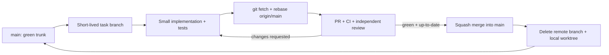

# Trunk-based development & agent collaboration policy

**Status:** binding for implementation work in wAInery. This policy refines the [agentic SDLC](../80-delivery/agentic-sdlc.md), [team topology](agent-team-topology.md) and root [AGENTS.md](../../AGENTS.md). **One trunk = `main`; no permanent `develop` or per-team integration branches.** The objective is short feedback loops, readable history and low integration risk while delivering the MVP's business outcome: affordable, evidence-grounded next-action recommendations for Polish vineyard/cellar conditions.

## The one normal path



**Mandatory order:** `rebase` onto **current** `origin/main` **before** final PR validation/merge. CI on a stale PR is insufficient. If `main` advances after validation, rebase and rerun checks. **Squash merge** is the default for one focused feature/bugfix (one cohesive commit in trunk); a documented exception may use rebase-and-merge where distinct commits are independently useful. **No merge commits from feature branches, no direct push to main, no force push to main.** Never merge an unrebased branch, even when it has no textual conflicts.

## Branches: short lived and disposable

- Name: `feat/<module>/<ticket>`, `fix/<module>/<ticket>`, `docs/<ticket>`, `test/<scope>/<ticket>`, `chore/<scope>/<ticket>`. Legacy `agent/<module>/<ticket>` is still accepted during transition.
- Start from fresh `origin/main`, not another active feature branch. Dependencies: publish contract/mock seam in a separate small PR, then branch/rebase dependents onto trunk.
- Aim for **hours to 1–2 working days** per branch, **one behavior**, one owning module. A suggested review-size target is **up to ~300 changed non-generated lines**; exceptions are justified in PR, not artificially split code into unusable states. No long-running per-module branches.
- Every merge must leave `main` compilable, tested, secure and deployable as the currently implemented local host — not necessarily fully MVP-functional. Use incremental contracts, adapters and feature flags to keep incomplete features inactive.
- If a task is too big to review, split by behavior: schema/contract + consumer fixtures; read model; canonical write/outbox; prediction invalidation; model integration; local report. Keep steps meaningful and testable.
- Feature branches are **not environments**. Avoid commits containing private scanned books, OCR, actual winery notes, embeddings, provider secrets or unapproved external data.

## Git procedure for each ticket

```bash
git fetch origin
git switch main
git pull --ff-only origin main
git switch -c feat/weather/immutable-forecast-runs

# implement a bounded behavior + tests, commit incrementally on the feature branch
git add -A && git commit -m "feat(weather): record immutable forecast runs"

git fetch origin
git rebase origin/main
# if rebased commits were already pushed: verify ownership, then
git push --force-with-lease -u origin HEAD
# if first push: git push -u origin HEAD
# open PR, wait for all required checks and independent reviewer
# if main moves, REPEAT fetch/rebase/push and checks before merge
```

`--force-with-lease` applies **only to one's own short-lived feature branch**, never `main`. Resolve conflicts deliberately; **never** use `--ours`/`--theirs` to discard an owner's changes indiscriminately. Do not rebase an agent's branch if another agent is actively writing to it.

**Final merge:** authorized integrator verifies branch is up-to-date, CI green at the latest head, independent review complete, tests appropriate to the changes and business acceptance evidence. Use **Squash and merge** by default. If CI is configured to detect stale branch and fails, rebase; never bypass the check.

## Collaboration between agents

| Concern | Rule |
|---|---|
| Parallel edits | One agent = one worktree/branch and exclusive path ownership; no two agents commit to the same branch or shared file concurrently |
| Contract changes | Propose through `agents/handoffs/`; Integration Owner commits **small contract PR first**; affected agents rebase after merge |
| Shared areas | Only Integration Owner changes Host, BuildingBlocks, central migrations, shared wire schemas, CI and solution files; module agents request changes |
| Domain boundaries | Vineyard/Winery own performed operations; Observations owns measurements; Decisions owns plans/ranking; AIExecution is a replaceable tool provider |
| Handoff | PR includes consumed contract versions, build/tests actually executed, correctness limits, time/as-of effects, rights/egress, API cost and next dependent ticket |
| Review | Reviewer is not the code author; reviewer may delegate static scan but must check diff, tests and user-facing scenario |
| External dependencies | If waiting on another module, use its approved contract and a deterministic fake; do not read/write foreign tables |
| Failure | If contract or domain owner is unclear, stop and escalate; no speculative change to 3 modules for one feature |

**Target concurrency:** one Integration Owner and 1–2 active coding agent worktrees at first, growing to a maximum of four bounded streams after Wave 0 and the first integrated vertical slice. Eight bounded contexts are **not** eight always-running independent coding teams.

## Test and quality gates (the source of truth is GitHub checks)

All feature PRs:
1. Run `dotnet restore wAInery.slnx`, `dotnet build wAInery.slnx --configuration Release`, architecture/project-reference checks, unit tests for the affected module and schema checks for modified public contracts **when those test projects exist**.
2. For persistence changes: execute actual PostgreSQL+pgvector Testcontainers migrations, constraints, outbox/duplicate/replay tests. Do not claim these pass from a static SQL file.
3. For prediction: prove narrow invalidation, no unnecessary external LLM call, stale revision protection, as-of consistency and fallback on budget exhaustion.
4. For Knowledge/AI: check private book rights and external egress, prompt-injection resistance, grounded citations, no fabricated probability, model cost per accepted plan.
5. For business changes: record affected `BR-` requirement and at least one positive and negative fixture. Later MVP release evaluation is independently judged on 30–50 expert-reviewed scenarios.

If a test suite does not exist, **implement an appropriately scoped one first**. CI currently covers solution build + architecture graph; new integration tests must be wired to CI as they become available. `main` must not knowingly regress; avoid fake green tests and disabling checks for convenience.

## Merge and cleanup

- PR must target `main`; no permanent integration branch. `main` is always the only shared integration point.
- Rebase before merge, rerun required tests on the updated head, then **squash merge**. For shared contract/migration changes, Integration Owner also verifies downstream consumer fixtures.
- Delete the **remote** feature branch **only after** GitHub confirms a successful merge and required integration checks; never delete an unmerged branch simply because it is old.
- Delete local worktree/branch after merge, preserving any untracked changes safely. Reference PR/commit in handoff. A reopened bug uses a **new** branch from current `main`, not the old branch.
- GitHub Actions `cleanup-merged-branches.yml` removes eligible same-repo remote heads after successful merge, while respecting the base branch. Repo setting **Automatically delete head branches** is an optional complementary safeguard.
- Clean old branches on discovery only after `git merge-base --is-ancestor origin/<branch> origin/main` is true; check no open PR depends on the branch. Do not force-delete unknown/unsquashed work.

## GitHub repository settings to enable (human / admin)

In **Settings → General → Pull Requests**: enable **Squash merging**, disable **Merge commits** (and optionally disable Rebase merging if squash-only policy is desired), enable **Automatically delete head branches**.

In **Settings → Branches / Rules → Rulesets** for `main`: require PR before merging; at least one reviewer; require status checks (**Monorepo structural checks** and **PR rebased on main**); **require branch to be up to date before merging**; block force pushes and deletion; restrict direct pushes. Prefer CODEOWNERS as the project matures. Repository settings are not changed by committing this document or workflow.

**Cost discipline:** all of this uses GitHub/Git without a new paid service. Focus on incremental MVP functionality before additional tooling.

[Implementation task template](../../agents/templates/implementation-task.md) | [PR template](../../.github/pull_request_template.md) | [Testing strategy](../70-quality/implementation-test-strategy.md).
