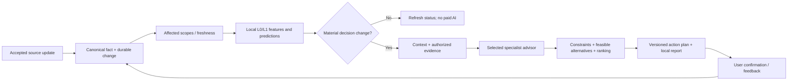

# Business HLD — wAInery Smart Winery AI

**Status:** approved business direction, architecture review baseline; **not an implemented or clinically/agronomically validated decision product**. This page is the concise product-level contract for all LLD and implementation work. [Business traceability](business-requirements-traceability.md) | [Architecture review](../70-quality/architecture-review-2026-11.md).

## Business need and outcome

A single Polish vineyard/winery owner needs to know **what to do next, when, why, and which viable alternatives exist**. The system must react when information changes, without rereading all documents or calling every agent for every update. The output is a **versioned and evidence-backed action plan**, not merely a conversational answer.

A plan states the affected block/batch, current decision status/freshness, priority, action windows/deadlines, feasible compatible actions and prerequisites, the preferred action/set with rationale, rejected or deferred alternatives, uncertainty, missing facts, source citations and the next review trigger. **Numerical event or effectiveness probabilities are optional and must come from named, evaluated models — never from LLM confidence.** A request to measure or to do nothing can be the best recommendation.

## MVP product boundary

| Inputs — MVP | Output — MVP | Not in MVP |
|---|---|---|
| 1–2 private scanned books (local OCR + RAG); curated online publications with rights/provenance; owner-confirmed, descriptive vineyard and cellar operations/observations; one free weather forecast adapter | Local CLI/localhost report, persisted prediction states and action-plan revisions, alternatives, applicable Polish context, citations, measured AI cost | Physical IoT sensors, weather station, always-on monitoring, emails/push, SaaS/multi-user access, rich UI, cloud hosting, automatic physical intervention |

**Success means expert-reviewed decision usefulness on 30–50 representative scenarios** (including contradictions, missing information and revised data), compared with cheaper baselines. Retrieval scores alone are not sufficient; true future-event forecasting accuracy requires historical outcomes and later calibration. Proposed thresholds are acceptance targets, not measured quality.

## Business process

- A data update invalidates **only potentially dependent** predictions; it does not always justify a model call or new notification. Processing is restartable and revision-aware. While the local computer is off there are **no live alerts**.
- Canonical operations require explicit confirmation; suggested actions are not performed actions. Measurement types/units, wine batch versus vessel history, forecast issue versus retrieval time and source known-at time remain distinct.
- Advice combines **local facts**, curated evidence and scientific results with explicit climate/variety/phenology transferability. Being written in Polish is not proof of relevance; a book is not the sole authority. Legal plant-protection constraints and missing critical facts may veto an action.
- Protected book scans/OCR stay private, source rights are attached to evidence and external model egress is **DENY by default** unless explicitly approved. No book content, secrets, production notes or embeddings in Git.

## Context and dependency boundaries

| Type | Module | Owns |
|---|---|---|
| Core | **Vineyard** | Planting context, phenology, confirmed field work |
| Core | **Winery** | Wine batches, vessels, occupancy and confirmed cellar work |
| Core | **Decisions** | Scoped predictions, alternative actions, ranking, versioned plans |
| Supporting | **Observations** | Typed observations, units, quality and measurement lineage |
| Supporting | **Weather** | Immutable forecasts, local applicability and known-at semantics |
| Supporting | **Knowledge** | Documents, evidence, citations, rights and retrieval |
| Platform module | **Connectivity** | Source adapters, raw receipts, proposals, replay |
| Platform module | **AIExecution** | Model/provider gateway, specialist roles, usage and tool/egress controls |

This is a **modular monolith**, one local .NET 10 host and PostgreSQL/pgvector, with local file storage and metered AI API only when justified. All cross-module reads/writes go through owner-controlled ports and versioned events. The `Decisions` ↔ `AIExecution` relationship is a port/adapter call, **not** an implementation dependency cycle. Separate UI and notification channels consume public read models/events later; **do not add services for them to MVP**.

## Evolution without premature infrastructure

| Phase | Business capability |
|---|---|
| **0 — MVP** | Measure recommendation quality with books, curated web, history and weather; low-cost local runtime |
| **1 — Connected Winery** | On-site station, vessel temperature, pH/Brix/acidity and other typed sensor/lab inputs via source and measurement registries |
| **2 — Proactive Intelligence** | Additional specialist advisors, calibrated predictions, scheduled reports and extensible notifications |
| **3 — Cloud / channels** | Secure internet access, multiple UIs, scalable workers and resilient hosting |
| **4 — Commercial** | Tenant isolation, commercial-eligible knowledge, licensing and product governance |

Cheap additive database migrations and rebuilding derived indexes are acceptable; preserving canonical data, independent provider swaps and controlled operating cost matter more than avoiding all migrations.

## MVP release questions

1. Does a reviewed scenario produce a **safe, applicable preferred action and sensible timing**, plus reasonable alternatives and missing-data caveats?
2. Does a change to one block/batch update the relevant prediction/plan **without** triggering unrelated paid analysis?
3. Can we trace every recommendation to facts known at the time, legitimate source evidence, a model/policy version and measured cost?
4. Can seven module teams work in parallel **after** the Integration Owner has frozen common contracts and migration conventions?
5. Does the local prototype remain usable with LLM/weather outages, without claiming continuous availability or inventing certainty?

[Prediction catalog](../90-lld/prediction-catalog.md) | [Evaluation protocol](../90-lld/evaluation-protocol.md) | [First vertical slice](../80-delivery/mvp-vertical-slice.md) | [Owner/context map](../20-domains/context-map.md).
