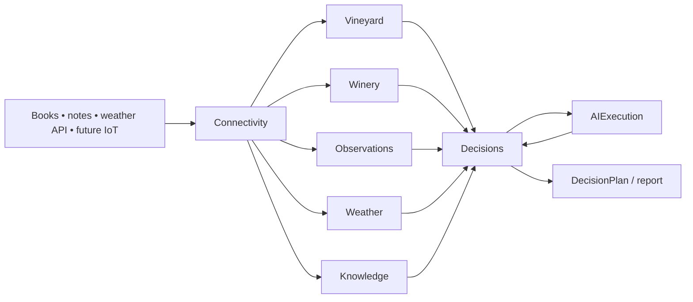

# Context map — Smart Winery AI

Status: **Gate 2 accepted**. Domain decomposition; Gate 3 component boundaries also accepted. LLD is reviewed with remaining Wave 0 implementation prerequisites.

## Context classification

| Context | DDD role | MVP responsibilities | Evolves later |
|---|---|---|---|
| **Vineyard** | Core domain | Planting/sector profile; variety mix; phenological state; vineyard activities and outcomes | Rows/vines, pests, treatments and field resources |
| **Winery** | Core domain | Wine batches, vessels, stages, manual cellar operations, batch genealogy | Transfers/blends/splits, detailed fermentation recipes |
| **Decisions** | Core domain | Change impact, scoped predictions, candidate actions, ranking, decision plans, version/history | Statistical calibration, planning optimizer and active alerts |
| **Observations** | Supporting domain | Immutable typed measurements and descriptive observations for any subject; data quality and units | Sensors, high-frequency signals, aggregations |
| **Weather** | Supporting domain | Provider forecast runs, location context, time windows; freshness and provenance | On-site station and weather fusion, microclimate |
| **Knowledge** | Supporting domain | Books and curated web sources, rights, versions, evidence/retrieval | Broader research, validated playbooks, multiple workspaces |
| **Connectivity** | Generic/platform | Source registry, imports/sync, raw capture, normalization dispatch and replay | MQTT, sensor gateways, external APIs |
| **AIExecution** | Generic/platform | Model-neutral inference, agent roles, tool invocation policies, spend/usage trace | Model routing, multiple vendors, specialist agents |

**Not bounded contexts in MVP:** `Evaluation` (offline test harness and benchmark data); `Notifications` (deferred transport and inbox); `Identity` (future access solution); `IoT` (future connectivity adapters). Do not misrepresent these as business-domain aggregates.

## Context relationship direction

These are **logical information flows**, not permission to import domain entities or query private tables. The direction `Decisions ↔ AIExecution` is request/response through a model-neutral port; it is not a source-level circular dependency. Contexts communicate with typed query ports and versioned integration events. Platform/Host wires adapters and consumers.

## Data ownership invariants

- One and only one owner of each mutable business fact, regardless of how many read models repeat it.
- Vineyard **owns** a vineyard operation. Winery **owns** a cellar operation. Connectivity keeps the original submitted note/envelope, not a competing canonical operation.
- Observations **owns** original normalized measurement/observation records. Vineyard/Winery may maintain a curated/approved stage or state, but cannot silently alter the measurement record.
- Weather **owns** forecast runs with provider and `issuedAt` timestamps. A forecast is not an observed meteorological fact. Future station readings belong to Observations.
- Knowledge **owns** document versions, extracted source spans, IP policy and searchable evidence. Neither an embedding nor an LLM response is an authoritative record of operations.
- Decisions **owns** predictions, alternative actions, justification, selection, plan revisions and disposition. AIExecution owns model invocations; it does **not** own domain decisions.
- No cross-context writes; no EF navigation entities or cross-schema foreign keys between contexts. References travel via stable IDs and are validated by ports/services.
- Every domain record carries `WorkspaceId` from MVP. This does not imply multi-tenancy is implemented now.

## Domain versus infrastructure scale

All eight contexts run in **one local .NET host and one PostgreSQL database** for MVP. Dedicated schemas separate data ownership; no extra broker, database or runtime per context. Migrations are expected and can be additive; migrating the entire source of truth is not expected. Later scale contexts individually by extracting adapters/processes without changing semantics.

## Explicit anti-patterns

1. A universal `Operation` table used by both vineyard and winery without domain semantics.
2. A universal `knowledge` table containing sensor streams and current domain state.
3. Agents writing directly to core-domain tables.
4. Weather forecasts treated as ground-truth measurements.
5. Generic JSON-only CRUD replacing important domain invariants.
6. Every telemetry update invoking every agent.
7. Agent platform dictating persistence or ownership of `DecisionPlan`.
