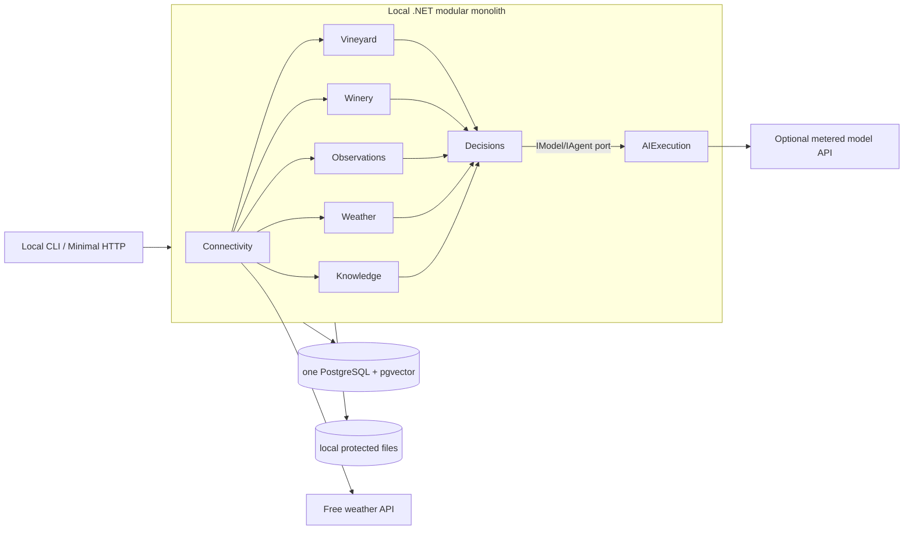

# Gate 3 — component map and module seams

**Status: proposal for user review (Gate 3).** Gate 1 layout and Gate 2 domain boundaries are approved. This is **not** a frozen, build-ready full LLD or a completed implementation.

## Deployment view (MVP)

The drawing shows **runtime flow**, not source references or cross-context table access. The host composes cross-module ports with DI.

## Responsibilities and component candidates

| Module | Components (MVP) | Later plug-in extensions |
|---|---|---|
| Vineyard | ProfileRegistry; ActivityJournal; PhenologyState; VineyardReadFacade | row/vine, disease observation, treatment eligibility |
| Winery | BatchRegistry; VesselRegistry; CellarOperationJournal; WineryReadFacade | blend/split and detailed chemistry/recipes |
| Observations | MeasurementCatalog; ObservationLedger; QualityValidator; ObservationReadFacade | IoT stream ingestion, calibration, aggregates |
| Weather | ForecastCatalog; ForecastDiff; WeatherReadFacade | weather-station reconciliation, microclimate |
| Knowledge | DocumentVault; ExtractionPipeline; EvidenceIndex; HybridRetriever; RightsPolicy | more books/web, rerankers, research curation |
| Connectivity | SourceRegistry; RawInbox; SourceAdapters; ImportDispatcher; SyncScheduler | MQTT/device gateway, other providers |
| Decisions | ChangeImpact; PredictionRegistry; RecomputeScheduler; ContextAssembler; ActionEvaluator; DecisionPlanner; DecisionReadFacade | calibrated probabilistic models, advanced optimizer |
| AIExecution | ModelGateway; AgentRoleRouter; ToolBroker; EgressPolicy; UsageMeter | more providers/models, multimodal roles |

## Contract strategy (non-negotiable)

- Domain owners publish *read/query* DTO and *command* ports in public `*.Contracts` assembly; internal entities and EF repositories are private.
- Platform-neutral exchange types (`WorkspaceId`, `SubjectRef`, `TimeRange`, `SourceVersionRef`, `Result/Error`) live in small `BuildingBlocks.Contracts` **owned by integration agent**.
- `Decisions` owns a model-neutral `IReasoningExecutor` port request/response schema. `AIExecution` implements it via an adapter registered by Host. **Neither module references the other's implementation** and no dependency cycle is permitted.
- Events pass through **transactional Postgres Outbox** using a common envelope with a typed event name/payload. Names and consumers are catalogued in `docs/40-contracts/catalog.md`; machine schemas in `/contracts` are preliminary until Gate 3 approval.
- `Connectivity` does not interpret business truth and cannot mark an operation performed by LLM extraction alone. It submits typed proposal commands to canonical owner.
- `Knowledge` does not store current batch/vineyard truth; retrieval is evidence, never an instruction channel or business authority.
- `Decisions` may consume query ports of other modules, but cannot write their tables or update their aggregates.
- Later Notification interfaces attach as consumers of `DecisionPlanPublished`; **do not** couple email to Decisions.

## Sequence and recomputation

See `docs/30-components/incremental-workflow.md`; event publication must happen in the same transaction as canonical writes, dispatch at-least-once, dedup in consumer. No LLM call before materiality filtering.

## Nonfunctional MVP bounds

- Local host can be turned off; on restart, pending jobs/replays must resume. No claims of 24/7 alerting.
- Budget per evaluation run and production AI call, throttling/retries and no-provider fallback are mandatory. No subscription assumptions.
- Store source and data lineage; time-aware evaluation must avoid knowledge from future issued forecasts.
- Public authentication and multi-tenant isolation deferred; keep `WorkspaceId` in canonical contracts and avoid unnecessary internet exposure.

## Review questions for user

1. Approve component seams and contracts for eight modules, including ContextAssembler in Decisions and ToolBroker/ModelGateway in AIExecution?
2. Approve PostgreSQL Outbox + lightweight worker and no broker in MVP?
3. Approve explicit draft-to-confirmed operation import, even if manual note entry requires a confirmation step?
