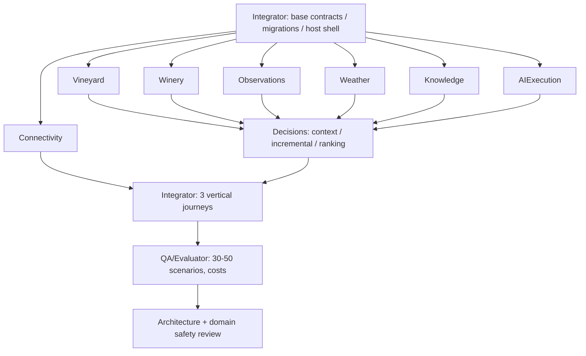

# Parallel implementation DAG — planned agent work packages

**Gate 3 accepted; Wave 0 not yet completed.** Architectural approval does not authorize work against unfrozen compile-time contracts. Independent agents own module internal paths; integration owner owns shared contracts, migrations bootstrap, host and CI. Preserve small fixed cost and quality-first scope.

## Implementation order and seams

**Wave 0 — Integration owner (serial, short)**: skeleton .NET solution, `BuildingBlocks.Contracts`, agreed schemas/event envelope, shared fixture generator, PostgreSQL bootstrap and local compose. Agent assignments go active after schema version freeze. Source-level graph: domain modules can import BuildingBlocks and others' contract assemblies; never other's implementation. AIExecution implements Decisions-owned neutral port through Host DI.

**Wave 1 — Parallel (independent)**: Vineyard, Winery, Observations, Weather, Knowledge, Connectivity, AIExecution. Each writes only `src/Modules/<name>/**`, `tests/Modules/<name>/**`, module-specific LLD notes, and agent handoff. Changes to shared contracts require integration-owner PR; no simultaneous shared-file edits. Connectivity adapters can mock target command ports while canonical owners are still in development.

**Wave 2 — Decisions**: after stable owner read DTOs and `IReasoningExecutor`, implement impact, prediction states, coalescing/recompute, context assembly, ranking, as-of snapshots, plan persistence. Prototype/mocks allowed in parallel early, integrate after Wave 1 contracts.

**Wave 3 — Integrator**: wire ingestion → canonical writes → outbox → Predictions → limited AI → plan report. Test three journeys, crashes/replays, stale forecast, no irrelevant LLM calls, budget caps, rights enforcement.

**Wave 4 — QA and independent reviews**: expert-reviewed scenarios, retrieval/citation quality, Polish relevance, ranking feasibility, probability provenance, failure safety, and measured total API cost. Reviewer is separate from module implementation owner where feasible.

## File ownership and conflict policy

- `contracts/**`, `src/Host/**`, `src/BuildingBlocks/**`, `infra/**`, `.github/**`, central migration runner: **Integration Owner**.
- `src/Modules/<module>/**`, `tests/Modules/<module>/**`: **that module agent**.
- `tests/Contracts/**`, `tests/Architecture/**`, `tests/Integration/**`, `tests/Evaluation/**`: assigned QA/Integrator; bounded PR ownership.
- Module agent proposes contract additions in `agents/handoffs/<agent>-contract-change.md`, does not modify shared files itself.
- No agent imports `src/Modules/OtherModule` internals or uses EF entity classes across boundaries.

## Completion criteria for each package

README scope, interface/DTO with version, consumer example, failure & idempotency semantics, migration, tests, measured cost impact, no secrets/protected contents, and handoff note. This gate documents **what** to build; Gate 4 finalizes **how**, including all DB DDL, class diagrams, algorithms, edge-case tests and provider adapters.

## Implementation scaffold available

A `wAInery.slnx` .NET 10 solution, loopback-only Host, eight module Contracts + implementation project pairs, ArchitectureChecks and local PostgreSQL Compose are now present on the monorepo bootstrap branch. This **does not complete Wave 0**: the business ports still require compiling DTO implementations, actual database migration tests and durable workflows. See [monorepo bootstrap](monorepo-bootstrap.md).

## Implementation stream sizing and SDLC

The eight modules are **bounded code/data owners, not eight teams that must run in parallel**. For the cost-constrained MVP, schedule four workstreams: Domain State (Vineyard+Winery), Data Acquisition (Connectivity+Observations+Weather), Knowledge & AI (Knowledge+AIExecution), and Decisions; one Integration Owner owns shared Contracts, Host, CI and migration assembly. Start with 1–2 active coding sessions, worktrees and narrow PRs, plus independent QA. This refines the Wave 1 parallel graph without changing bounded-context ownership.

Read [team topology](../00-governance/agent-team-topology.md), [full SDLC](agentic-sdlc.md), [test strategy](../70-quality/implementation-test-strategy.md) and [Codex workflow](codex-development-workflow.md). Wave 0 remains incomplete until actual public contracts compile and PostgreSQL migration/replay tests run.
